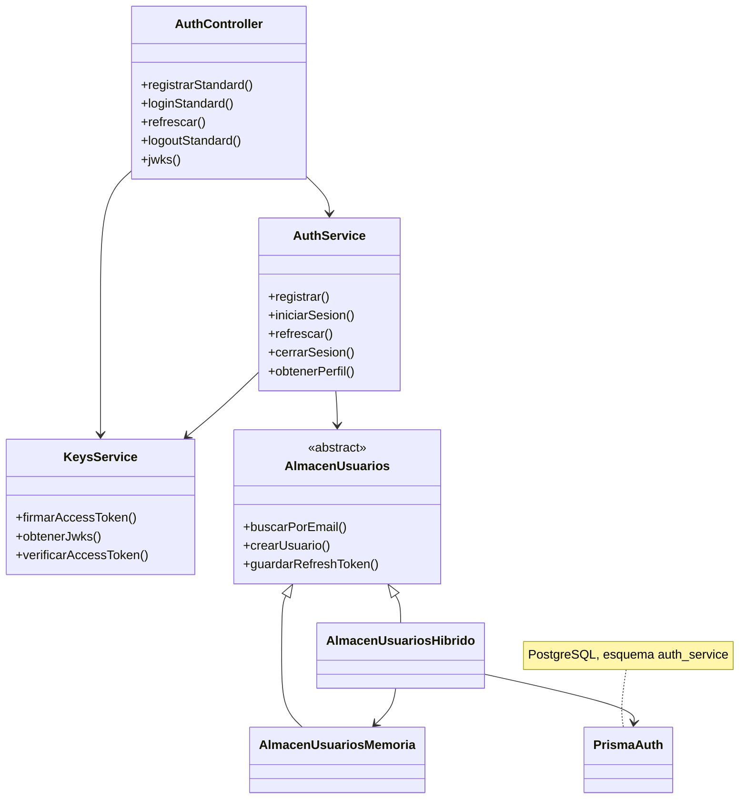
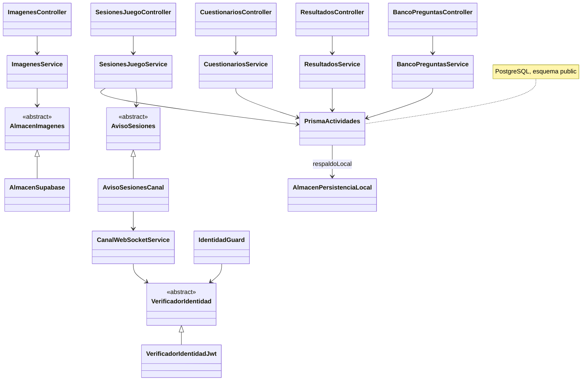

# Diagrama de clases

Este diagrama describe las clases que el código registra hoy. El diagrama de despliegue ya está en [entrega-persona-5.md](../entrega-persona-5.md) y no se repite aquí.

`actividades` no importa clases de `autenticacion`. Recibe un JWT y valida la firma con la clave pública publicada en el JWKS. La clave privada y las tablas de usuarios permanecen en el servicio de autenticación.

## Autenticación

`AuthModule` registra `AlmacenUsuariosHibrido` como `AlmacenUsuarios`. Si PostgreSQL responde, ese almacén usa el esquema `auth_service`. Si no hay conexión, delega en `AlmacenUsuariosMemoria`. `VerificadorIdentidadPendiente` existe en el código de actividades, pero `AutenticacionModule` no lo registra: la implementación activa es `VerificadorIdentidadJwt`.

## Actividades

`SesionesJuegoModule` registra `AvisoSesionesCanal` como `AvisoSesiones`. Después de confirmar una transacción, el canal emite solo a los sockets de esa sala. `CanalWebSocketService` acepta el JWT en `Sec-WebSocket-Protocol` (`profelink` y `profelink-bearer.<JWT>`) y consulta `AUTH_JWKS_URL`. No abre la base de usuarios.

`ImagenesModule` registra `AlmacenSupabase` como `AlmacenImagenes`. PostgreSQL guarda la metadata; el binario sale a Supabase Storage. `PrismaActividades` usa el esquema `public` y, si `DIRECT_URL` no está configurada, las lecturas de desarrollo caen en `AlmacenPersistenciaLocal`.

