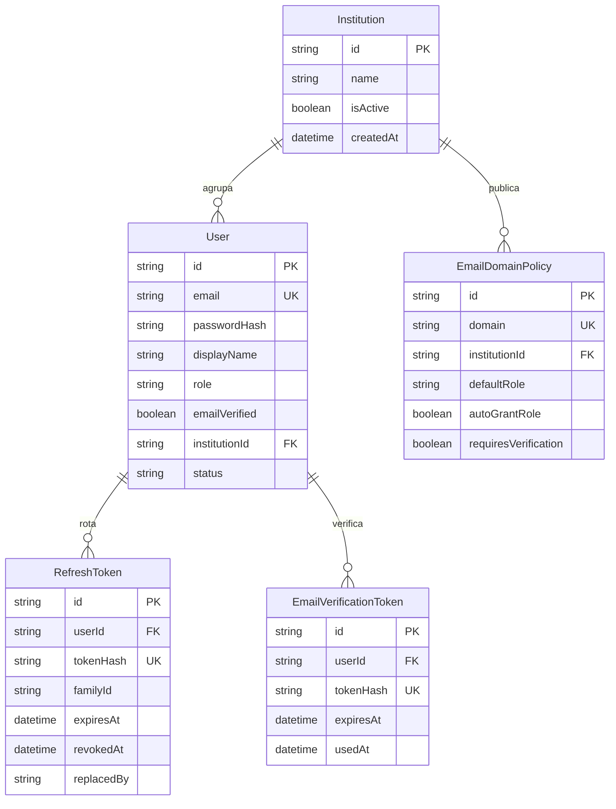
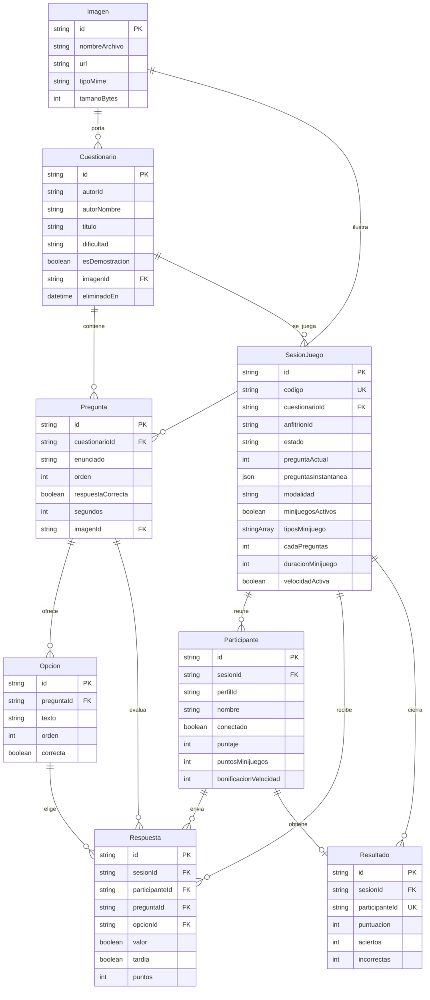

# Modelo de datos

Hay dos esquemas PostgreSQL en la misma instancia de producción y, en la instalación local, en la misma base. No existe una clave foránea entre ellos. `actividades` no lee `passwordHash`, refresh tokens ni políticas de dominio.

La topología de procesos está en [entrega-persona-5.md](../entrega-persona-5.md).

## Esquema `auth_service`

Definido en `autenticacion/prisma/schema.prisma`. Lo usa solo `auth-service`.

`RefreshToken.tokenHash` guarda el hash del refresh token, no el token en claro. La clave privada RSA no está en estas tablas: vive en el volumen `profelink-auth-keys`.

## Esquema `public` de actividades

Definido en `actividades/prisma/schema.prisma`. `Imagen` guarda metadata. El binario de una imagen subida por la aplicación va a Supabase Storage. Las portadas sembradas apuntan a archivos estáticos del frontend, por ejemplo `/portadas/funcional.svg`.

`SesionJuego.estado` usa el enum `EstadoSesion`: `esperando`, `pregunta`,
`cerrada`, `clasificacion` y `minijuego`. Las opciones de minijuegos se guardan
en `SesionJuego`; sus puntos y la bonificación de velocidad quedan asociados
a cada `Participante`.

## Referencias lógicas, sin clave foránea

| Columna en `public` | Identidad en `auth_service` | Uso |
| --- | --- | --- |
| `Cuestionario.autorId` | `User.id` | Dueño del cuestionario. El banco sembrado usa `perfil-demo`. |
| `SesionJuego.anfitrionId` | `User.id` | Docente que abre la sala. |
| `Participante.perfilId` | `User.id` | Participante autenticado. Hay un único par por sala. |

Esos tres valores viajan dentro del JWT (`sub`) después de que `auth-service` firma el token. `actividades` no puede hacer `JOIN` con `User`.
