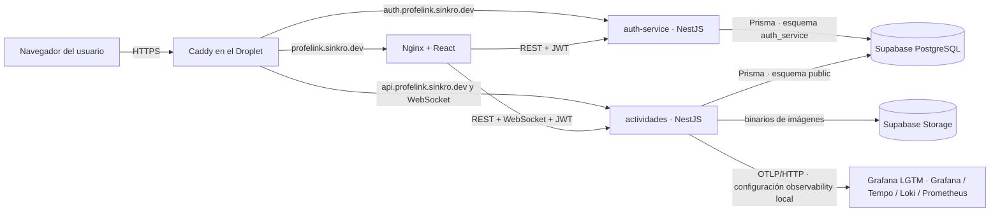

# Cierre de Persona 5: infraestructura, calidad e integración

## Arquitectura desplegada



Caddy termina HTTPS en el host. En producción, Docker publica frontend y APIs solo en `127.0.0.1`; no se publican directamente a Internet. `docker-compose.observability.yml` agrega el stack LGTM para observabilidad local; el puerto de Grafana también queda ligado a localhost.

## Persistencia y secretos

- Las tablas de autenticación se encuentran en `auth_service`; las tablas de actividades permanecen en `public`, en la misma instancia Supabase existente.
- Las imágenes se guardan como objetos en Supabase Storage y sus metadatos en PostgreSQL. No se guardan los binarios en el filesystem efímero del contenedor.
- El volumen Docker `profelink-auth-keys` conserva las claves RSA del emisor. Los archivos `.env` y `autenticacion/certs/supabase-root.crt` son configuración local/operativa y no deben versionarse.
- No se guardan contraseñas demo en documentación pública. Las credenciales de presentación deben compartirse por un canal privado.

## Comprobaciones reproducibles

Desde la raíz del repositorio:

```powershell
docker compose config --quiet
docker compose --env-file .env.production.example -f docker-compose.yml -f docker-compose.prod.yml -f docker-compose.observability.yml config --quiet
```

Pruebas locales por componente:

```powershell
Push-Location .\actividades; npm test -- --runInBand; Pop-Location
Push-Location .\autenticacion; npm test -- --runInBand; Pop-Location
Push-Location .\cliente-adicional; node --test .\prueba-carga-lectura.test.mjs; Pop-Location
```

Con los servicios locales levantados, el cliente independiente ejecuta solamente `GET` y limita destinos a loopback:

```powershell
node .\cliente-adicional\prueba-carga-lectura.mjs
```

Validación de API de actividades: `/openapi.json` devuelve el documento OpenAPI y `/reference` sirve Scalar. Salud: `/health/ready` para autenticación y `/salud` para actividades. La guía de DigitalOcean está en [despliegue-digitalocean.md](despliegue-digitalocean.md).

## Evidencia observada

- El 2026-11-07 se completó una demo punta a punta con docente y estudiante: creación y recarga de un cuestionario, ingreso a sala, dos respuestas, cálculo de puntaje y consulta del historial. El registro resumido está en [evidencias/demo-punta-a-punta-2026-11-07.md](evidencias/demo-punta-a-punta-2026-11-07.md).
- La suite de Actividades pasó: 13 suites, 79 pruebas. Las pruebas focalizadas de imágenes pasaron: 8 pruebas. El cliente de carga pasó: 4 pruebas. Estos resultados verifican suites locales, no una prueba de carga contra producción.
- Se observaron trazas de `actividades` en Grafana/Tempo y se verificaron los endpoints de salud públicos después del despliegue previo.

## Pendientes conocidos

1. La prueba de concurrencia PostgreSQL necesita una base local aislada `actividades_concurrency_test_*`. En esta máquina Jest no recibió `ACTIVITIES_TEST_DATABASE_URL` aunque PowerShell la tenía en el proceso padre; por eso la prueba terminó con el error de variable obligatoria y **no se afirma que la concurrencia real haya pasado**.
2. No se hizo una carga sostenida contra el despliegue: los tests del cliente verifican el runner y sus límites; la demo en vivo tuvo un solo estudiante.
3. No se verificó el ciclo cargar-imagen → reiniciar servicio → recuperar el objeto desde una nueva sesión. La arquitectura usa Supabase Storage, pero la prueba end-to-end real requiere una escritura temporal y reinicio controlado; no se hizo para no tocar datos ni interrumpir producción sin consentimiento específico.
4. `cliente-adicional/index.html` todavía manda su JWT WebSocket en un parámetro de consulta. El cliente React y el contrato actualizado usan `Sec-WebSocket-Protocol`; el demo HTML no debe usarse para probar WebSocket hasta alinearlo.

Estos pendientes están separados de los checks que sí se observaron. No se publicó una imagen a un registry ni se redeployó como parte de este cierre.
